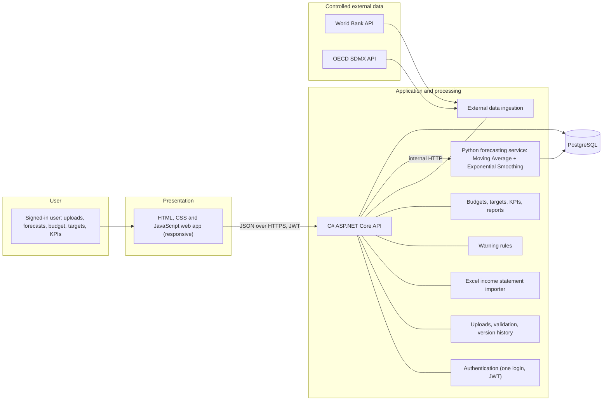

# RandAhead™, budget forecasting for SMEs

[](https://github.com/codePexx-ZA/randahead/actions/workflows/ci.yml)

*Clear forecasts. Confident decisions.*

A lightweight budget forecasting web app for **South African small and medium businesses**.

Businesses upload past **income statements** (Excel). The system forecasts each income statement category with **Moving Average** and **Exponential Smoothing**, raises warnings from South African economic data (inflation, fuel and electricity prices), and lets the user choose a budget and track targets and KPIs. It supports budgeting decisions; it is not an accounting system and gives no financial advice.

> **Solo rebuild of a university group project.** This repository is my independent end-to-end rebuild of the whole system. It reuses only the parts I wrote originally (database, external data service, forecasting service).

## Sign-in

There is one account, username `pexx`. Sign-in trims the username and ignores its case, so `Pexx` works. The password is stored only as a BCrypt hash on `app_user`. The signed-in user can do everything, from uploading income statements to choosing the budget, setting targets and rules, and editing the business details.

## Architecture

A decision support system in three layers: data input, processing and the web interface.



| Folder | Technology | Port | Purpose |
|---|---|---|---|
| [`database/`](database/README.md) | PostgreSQL 16 | 5432 | The only place tables are created (20 tables + reference data + fictional demo data); data design (ERD) |
| [`backend/`](backend/README.md) | C# .NET 10, ASP.NET Core, EF Core (Npgsql) | 5080 | Main API: login, business details, uploads, Excel importer, forecasts and the chosen budget (through the Python service), KPI targets, warning rules, external data ingestion, dashboard summary, reports, activity log |
| [`forecasting/`](forecasting/README.md) | Python, FastAPI | 5090 | Moving Average and Exponential Smoothing forecasts per category; called by the API only |
| [`frontend/`](frontend/README.md) | HTML, CSS, JavaScript | 5500 (static file server, outside Compose) | Login page + single-page app: dashboard, reports, upload, forecast & budget, targets & rules, business, activity log |
| `samples/` | Excel | | Fictional income statements for testing uploads (see [Upload statement](frontend/README.md#upload-statement)) |
| Mailpit (development only) | Mailpit | 8025 / 1025 | Catches support email when `MAIL_SMTP_HOST` is unset. The message is also stored in the activity log. A real inbox needs the SMTP settings in `.env` |

**Design rules**

- **The database owns the schema.** Tables are created only by `database/init/*.sql`. The API reads and writes existing tables and never creates or alters them; the forecasting service has no database access at all (the API sends it the history and saves the results).
- **One entry point.** The browser talks only to the C# API, which checks the sign-in token and then calls the forecasting service internally.
- **Transparent processing.** Forecasts use only Moving Average and Exponential Smoothing. External indicators raise visible warnings; nothing changes a figure without showing why.
- **Controlled external data.** Indicators come from reliable APIs (World Bank, OECD), are validated, and stored with their source, period, unit and validation status. No web scraping.
- **Reproducible.** The four services run with `docker compose up` from the repo root on one named volume; the frontend is static files served separately ([Run it](#run-it)).

## Status

| Part | Status |
|---|---|
| Database schema + reference data | Done |
| External data (World Bank, OECD) + warning rules | Done |
| Forecasting (MA + ES) | Done, runs end to end on the sample business |
| Sample business data | Done (`database/init/03_seed.sql`, fictional) |
| Login (API + web app) | One account (`pexx`) signs in through `POST /api/auth/login` (BCrypt + JWT) and may do everything; every other API endpoint needs the token; sign-in is rate limited per IP. Registration, user management, roles and password reset/change are absent |
| Business (API) | Done: `/api/business`, scoped to the signed-in user's business; the Business screen uses it |
| Uploads (API) | Done: `/api/submissions` (preview, save, version history). A saved statement is in use at once; an older upload whose years are all covered by newer ones is kept as a replaced version. The Upload statement screen uses it |
| Forecasts and budget (API) | Done: `/api/forecasts` (C# asks the Python service) and `/api/budgets` (choose MA, ES or their average; the choice is the budget at once). The web app offers three predictions, Steady (3-year average, weight 0.3), Balanced (3-year average, weight 0.5) and Recent (2-year average, weight 0.7), plus how far ahead (1–3 years). Forecast & budget, and the dashboard budget use them |
| Excel income statement importer | Done: C# + ClosedXML reads `.xlsx` / `.csv` on the server, standard template download. It reads annual files (one column per year) and monthly management-accounts workbooks (one sheet per year in any tab order, month columns, account codes); see [Monthly workbooks](backend/README.md#monthly-workbooks-management-accounts) |
| API error handling | Done: every failed request (bad input, missing sign-in, database down, unexpected error) answers with a readable `{ message }` the web app can show; server errors are logged with a trace id |
| Activity log | Done: every upload, decision and change is logged (`audit_log`, `GET /api/audit`); sign-in and sign-out are not |
| KPI targets, dashboard, reports | Done: `/api/kpi-targets`, and `GET /api/dashboard` (a year's figures vs the year before, budget vs actual once a budgeted year has actual figures, KPI target progress) behind the dashboard's KPI cards and Budget vs actual panel, and `GET /api/reports` (every year of the history and the chosen budget side by side, key ratios, targets; CSV download and print / PDF) |
| Web app screens | Login, dashboard (incl. KPI targets), reports, upload (incl. combining uploads into one history), forecast & budget, targets & rules (KPI targets, warning thresholds), business details and activity log, all open to the one signed-in user |

## Planned

| Area | State |
|---|---|
| One business, many stores | Not built. A business has one store (unit) and one history, so uploading a second store's workbook replaces the first store's years |
| AI line matching | Planned. Only account labels the importer cannot categorise go to a hosted model; the user confirms the suggestions. See [docs/ai-line-matching-plan.md](docs/ai-line-matching-plan.md) |
| Paid plans | Planned in the same document. Needs real accounts and public hosting first |

## Run it

The stack runs on the homelab notebook (Linux) with **Docker Engine** and the Compose plugin. Image builds pull the .NET 10 SDK image (`mcr.microsoft.com/dotnet/sdk:10.0`).

From the repo root:

1. Create the environment file and set both values (`POSTGRES_PASSWORD`, `JWT_KEY`; the key is a random string of at least 32 characters that signs the sign-in tokens):

   ```bash
   cp .env.example .env
   ```

2. Create the database volume. Compose declares `sme-budget_sme_budget_pgdata` as external, so it starts only when the volume already exists:

   ```bash
   docker volume create sme-budget_sme_budget_pgdata
   ```

3. Start the four services:

   ```bash
   docker compose up -d --build
   ```

4. Serve the frontend from the repo root, outside Compose:

   ```bash
   python3 -m http.server 5500 --bind 127.0.0.1 --directory frontend
   ```

The compose project is `randahead`. The containers are `randahead-postgres`, `randahead-api`, `randahead-forecast` and `randahead-mailpit`.

The database starts with a fictional business (Karoo Outdoor Supplies) and the one login from [Sign-in](#sign-in).

| Service | URL |
|---|---|
| Web app | http://127.0.0.1:5500 |
| C# API (Swagger) | http://127.0.0.1:5080/swagger |
| Python forecasting API | http://127.0.0.1:5090/docs |
| Mailpit (development inbox: support emails) | http://127.0.0.1:8025 |
| PostgreSQL | 127.0.0.1:5432, database `sme_budget`, user `budget` |

Every published port binds `127.0.0.1`, so the stack is reachable only from the machine it runs on; the frontend server binds the same address.

Load the external indicators once the API is up:

```bash
TOKEN=$(curl -s -X POST http://127.0.0.1:5080/api/auth/login \
  -H "Content-Type: application/json" \
  -d '{"username":"pexx","password":"<password>"}' | python3 -c 'import sys,json; print(json.load(sys.stdin)["token"])')
curl -s -X POST http://127.0.0.1:5080/api/ingestion/run -H "Authorization: Bearer $TOKEN"
```

Stop with `docker compose stop` (keeps data). `docker compose down` leaves the external volume in place; resetting the database is in [`database/README.md`](database/README.md#demo-data-03_seedsql).

Each folder has its own `README.md` with details.

## Automated checks

GitHub Actions ([`.github/workflows/ci.yml`](.github/workflows/ci.yml)) runs on every push to `main` and every pull request:

| Job | Checks |
|---|---|
| Database | Runs `database/init/*.sql` in order on a fresh PostgreSQL 16 |
| C# API | `dotnet build` in Release, warnings treated as errors; `dotnet test` on `backend/BudgetApi.Tests` (statement reading, income statement maths, EF model vs schema, the single login) |
| Forecasting | Algorithm doctests and that the FastAPI app imports |
| Frontend | `node --check` on every JS file; no hex colours outside `base.css`; no inline styles or scripts in HTML |

## Credits

Forecasting algorithms adapted from [TheAlgorithms/Python](https://github.com/TheAlgorithms/Python) (MIT): `simple_moving_average.py` and `exponential_moving_average.py`. Excel files are read by the API with [ClosedXML](https://github.com/ClosedXML/ClosedXML) (MIT). Charts use [Chart.js](https://www.chartjs.org/) (MIT).
