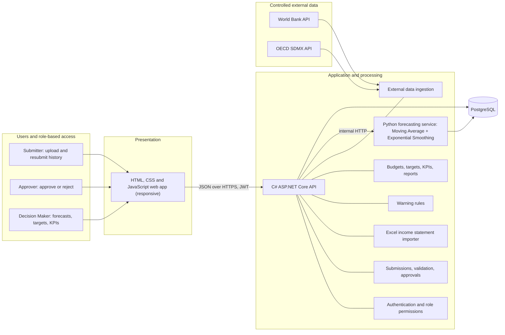

# RandAhead™ — SME Budget Forecasting System

[](https://github.com/codePexx-ZA/randahead/actions/workflows/ci.yml)

*Clear forecasts. Confident decisions.*

A lightweight budget forecasting web app for **South African small and medium businesses**.

Businesses upload past **income statements** (Excel). The system forecasts each income statement category with **Moving Average** and **Exponential Smoothing**, raises warnings from South African economic data (inflation, fuel and electricity prices), and lets managers approve budgets and track targets and KPIs. It supports budgeting decisions; it is not an accounting system and gives no financial advice.

> **Solo rebuild of a university group project.** This repository is my independent end-to-end rebuild of the whole system. It reuses only the parts I wrote originally (database, external data service, forecasting service).

## Roles

| Role | Can |
|---|---|
| Submitter | Upload income statement history, fix and resubmit rejected uploads |
| Approver | Approve or reject uploads and forecast budgets, edit warning thresholds |
| Decision Maker | View forecasts, budgets, targets, KPIs and warnings; set KPI targets |

## Architecture

A layered Decision Support System: **data input → processing → interface**.



| Folder | Technology | Port | Purpose |
|---|---|---|---|
| [`database/`](database/README.md) | PostgreSQL 16 | 5432 | The only place tables are created (22 tables + reference data + fictional demo data); data design (ERD) |
| [`backend/`](backend/README.md) | C# .NET 10, ASP.NET Core, EF Core (Npgsql) | 5080 | Main API: login, users and business details, uploads and approvals, Excel importer, forecasts and the chosen budget (through the Python service), KPI targets, warning rules, external data ingestion, dashboard summary, reports, activity log |
| [`forecasting/`](forecasting/README.md) | Python, FastAPI | 5090 | Moving Average and Exponential Smoothing forecasts per category; called by the API only |
| [`frontend/`](frontend/README.md) | HTML, CSS, JavaScript | 5500 (Live Server) | Login, register and password pages + single-page app: dashboard, reports, upload, forecast & budget, approvals, targets & rules, users & business, activity log |
| `samples/` | Excel | | Fictional income statements for testing uploads (see [Upload statement](frontend/README.md#upload-statement)) |
| Mailpit (development only) | Mailpit | 8025 / 1025 | Catches the API's emails (password reset links, support messages) so nothing is sent for real |

**Design rules**

- **The database owns the schema.** Tables are created only by `database/init/*.sql`. The API and the forecasting service read and write existing tables; they never create or alter them.
- **One entry point.** The browser talks only to the C# API, which checks the user's role and then calls the forecasting service internally.
- **Transparent processing.** Forecasts use only Moving Average and Exponential Smoothing. External indicators raise visible warnings; nothing changes a figure without showing why.
- **Controlled external data.** Indicators come from reliable APIs (World Bank, OECD), are validated, and stored with their source, period, unit and validation status. No web scraping.
- **Reproducible.** The full stack runs with `docker compose up` from the repo root.

## Status

| Part | Status |
|---|---|
| Database schema + reference data | Done |
| External data (World Bank, OECD) + warning rules | Done |
| Forecasting (MA + ES) | Done, runs end to end on the sample business |
| Sample business data | Done (`database/init/03_seed.sql`, fictional) |
| Login + register (API + web app) | Done: the login page signs in through `POST /api/auth/login` (BCrypt + JWT); a new business registers itself and its Decision Maker on `register.html` (`POST /api/auth/register`, default warning rules added); API endpoints need a token; sign-in, register and password reset are rate limited per IP |
| Passwords | Done: "Forgot password?" emails a one-time link (30 minutes; caught by Mailpit in development), managers set temporary passwords that must be changed at the next sign-in, and everyone can change their own password (`password.html`) |
| Users & business (API) | Done: `/api/business` and `/api/users` (add, edit, switch off, delete), scoped to the signed-in user's business; the Users & business screen uses them |
| Submissions, approvals (API) | Done: `/api/submissions` (upload, approve / reject, versioning); the Upload statement and Approvals screens use it |
| Forecasts and budget (API) | Done: `/api/forecasts` (C# asks the Python service) and `/api/budgets` (choose MA, ES or their average, approve / reject); Forecast & budget, the dashboard budget and budget approvals use them |
| Excel income statement importer | Done: C# + ClosedXML reads `.xlsx` / `.csv` on the server, standard template download |
| API error handling | Done: every failed request (bad input, missing permission, database down, unexpected error) answers with a readable `{ message }` the web app can show; server errors are logged with a trace id |
| Activity log | Done: every sign-in, upload, decision and change is logged (`audit_log`, `GET /api/audit`); the admin sees the whole business, everyone else their own actions |
| KPI targets, dashboard, reports | Done: `/api/kpi-targets`, and `GET /api/dashboard` (a year's figures vs the year before, budget vs actual once a budgeted year is approved, KPI target progress) behind the dashboard's KPI cards and Budget vs actual panel, and `GET /api/reports` (every approved year and the approved budget side by side, key ratios, targets; CSV download and print / PDF) for the Decision Maker |
| Web app screens | Login, dashboard (incl. KPI targets), reports (Decision Maker), upload (incl. combining uploads into one history), forecast & budget, approvals, targets & rules (KPI targets, warning thresholds), and users & business (users management, business details) done, each action limited to its role, plus an Admin account (database flag, for senior IT management) that can do everything and delete users while keeping their history |

## Run it

Needs **Docker Desktop** (running). From the repo root:

```powershell
Copy-Item .env.example .env      # first time only, then set JWT_KEY to a long random string
docker compose up -d --build
```

The database starts with a fictional business (Karoo Outdoor Supplies) and demo users; sign-ins are listed in `database/README.md`.

| Service | URL |
|---|---|
| C# API (Swagger) | http://localhost:5080/swagger |
| Python forecasting API | http://localhost:5090/docs |
| Mailpit (development inbox: password reset and support emails) | http://localhost:8025 |
| PostgreSQL | localhost:5432, database `sme_budget`, user `budget` |

Load the external indicators once the API is up:

```powershell
$login = Invoke-RestMethod -Method Post -Uri http://localhost:5080/api/auth/login -ContentType "application/json" -Body '{"email":"owner@demo.co.za","password":"demo123"}'
Invoke-RestMethod -Method Post -Uri http://localhost:5080/api/ingestion/run -Headers @{ Authorization = "Bearer $($login.token)" }
```

Stop with `docker compose stop` (keeps data). `docker compose down -v` deletes the database; it is rebuilt from `database/init/` on the next start.

Each folder has its own `README.md` with details.

## Automated checks

GitHub Actions ([`.github/workflows/ci.yml`](.github/workflows/ci.yml)) runs on every push to `main` and every pull request:

| Job | Checks |
|---|---|
| Database | Runs `database/init/*.sql` in order on a fresh PostgreSQL 16 |
| C# API | `dotnet build` in Release, warnings treated as errors |
| Forecasting | Algorithm doctests and that the FastAPI app imports |
| Frontend | `node --check` on every JS file; no hex colours outside `base.css`; no inline styles or scripts in HTML |

## Credits

Forecasting algorithms adapted from [TheAlgorithms/Python](https://github.com/TheAlgorithms/Python) (MIT): `simple_moving_average.py` and `exponential_moving_average.py`. Excel files are read by the API with [ClosedXML](https://github.com/ClosedXML/ClosedXML) (MIT) and in the browser demo with [SheetJS](https://sheetjs.com/) (Apache 2.0). Charts use [Chart.js](https://www.chartjs.org/) (MIT).
