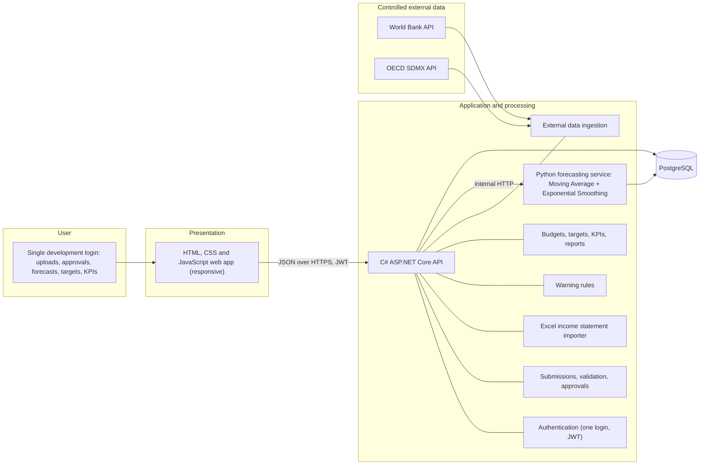

# RandAhead™, budget forecasting for SMEs

[](https://github.com/codePexx-ZA/randahead/actions/workflows/ci.yml)

*Clear forecasts. Confident decisions.*

A lightweight budget forecasting web app for **South African small and medium businesses**.

Businesses upload past **income statements** (Excel). The system forecasts each income statement category with **Moving Average** and **Exponential Smoothing**, raises warnings from South African economic data (inflation, fuel and electricity prices), and lets managers approve budgets and track targets and KPIs. It supports budgeting decisions; it is not an accounting system and gives no financial advice.

> **Solo rebuild of a university group project.** This repository is my independent end-to-end rebuild of the whole system. It reuses only the parts I wrote originally (database, external data service, forecasting service).

## Sign-in

| Username | Password |
|---|---|
| `demo123` | `test` |

There is one login and no roles: the signed-in user can do everything, from uploading and approving income statements to choosing and approving the budget, setting targets and rules, and editing the business details. **This is a temporary development login.** One shared account with a known password is not secure; sign-in and permissions must be revisited before any real use.

## Architecture

A decision support system in three layers: data input, processing and the web interface.



| Folder | Technology | Port | Purpose |
|---|---|---|---|
| [`database/`](database/README.md) | PostgreSQL 16 | 5432 | The only place tables are created (21 tables + reference data + fictional demo data); data design (ERD) |
| [`backend/`](backend/README.md) | C# .NET 10, ASP.NET Core, EF Core (Npgsql) | 5080 | Main API: login, business details, uploads and approvals, Excel importer, forecasts and the chosen budget (through the Python service), KPI targets, warning rules, external data ingestion, dashboard summary, reports, activity log |
| [`forecasting/`](forecasting/README.md) | Python, FastAPI | 5090 | Moving Average and Exponential Smoothing forecasts per category; called by the API only |
| [`frontend/`](frontend/README.md) | HTML, CSS, JavaScript | 5500 (Live Server) | Login page + single-page app: dashboard, reports, upload, forecast & budget, approvals, targets & rules, business, activity log |
| `samples/` | Excel | | Fictional income statements for testing uploads (see [Upload statement](frontend/README.md#upload-statement)) |
| Mailpit (development only) | Mailpit | 8025 / 1025 | Catches the API's emails (support messages) so nothing is sent for real |

**Design rules**

- **The database owns the schema.** Tables are created only by `database/init/*.sql`. The API reads and writes existing tables and never creates or alters them; the forecasting service has no database access at all (the API sends it the history and saves the results).
- **One entry point.** The browser talks only to the C# API, which checks the sign-in token and then calls the forecasting service internally.
- **Transparent processing.** Forecasts use only Moving Average and Exponential Smoothing. External indicators raise visible warnings; nothing changes a figure without showing why.
- **Controlled external data.** Indicators come from reliable APIs (World Bank, OECD), are validated, and stored with their source, period, unit and validation status. No web scraping.
- **Reproducible.** The full stack runs with `docker compose up` from the repo root.

## Status

| Part | Status |
|---|---|
| Database schema + reference data | Done |
| External data (World Bank, OECD) + warning rules | Done |
| Forecasting (MA + ES) | Done, runs end to end on the sample business |
| Sample business data | Done (`database/init/03_seed.sql`, fictional) |
| Login (API + web app) | Temporary development design: one login (`demo123` / `test`) signs in through `POST /api/auth/login` (BCrypt + JWT) and may do everything; every other API endpoint needs the token; sign-in is rate limited per IP. Registration, user management, roles and password reset/change are removed for now |
| Business (API) | Done: `/api/business`, scoped to the signed-in user's business; the Business screen uses it |
| Submissions, approvals (API) | Done: `/api/submissions` (upload, approve / reject, versioning); the Upload statement and Approvals screens use it |
| Forecasts and budget (API) | Done: `/api/forecasts` (C# asks the Python service) and `/api/budgets` (choose MA, ES or their average, approve / reject). The web app offers three predictions, Steady (3-year average, weight 0.3), Balanced (3-year average, weight 0.5) and Recent (2-year average, weight 0.7), plus how far ahead (1–3 years). Forecast & budget, the dashboard budget and budget approvals use them |
| Excel income statement importer | Done: C# + ClosedXML reads `.xlsx` / `.csv` on the server, standard template download |
| API error handling | Done: every failed request (bad input, missing sign-in, database down, unexpected error) answers with a readable `{ message }` the web app can show; server errors are logged with a trace id |
| Activity log | Done: every upload, decision and change is logged (`audit_log`, `GET /api/audit`); sign-in and sign-out are not |
| KPI targets, dashboard, reports | Done: `/api/kpi-targets`, and `GET /api/dashboard` (a year's figures vs the year before, budget vs actual once a budgeted year is approved, KPI target progress) behind the dashboard's KPI cards and Budget vs actual panel, and `GET /api/reports` (every approved year and the approved budget side by side, key ratios, targets; CSV download and print / PDF) |
| Web app screens | Login, dashboard (incl. KPI targets), reports, upload (incl. combining uploads into one history), forecast & budget, approvals, targets & rules (KPI targets, warning thresholds), business details and activity log, all open to the one signed-in user |

## Run it

Needs **Docker Desktop** (running). From the repo root:

```powershell
Copy-Item .env.example .env      # first time only, then set JWT_KEY to a long random string
docker compose up -d --build
```

The compose project is `randahead`. The containers are `randahead-postgres`, `randahead-api`, `randahead-forecast` and `randahead-mailpit`.

The database starts with a fictional business (Karoo Outdoor Supplies) and the one temporary development login, `demo123` / `test`.

| Service | URL |
|---|---|
| C# API (Swagger) | http://localhost:5080/swagger |
| Python forecasting API | http://localhost:5090/docs |
| Mailpit (development inbox: support emails) | http://localhost:8025 |
| PostgreSQL | localhost:5432, database `sme_budget`, user `budget` |

PostgreSQL and the Python forecasting API only listen on this computer (`127.0.0.1`), so other devices on the network can't reach them.

Load the external indicators once the API is up:

```powershell
$login = Invoke-RestMethod -Method Post -Uri http://localhost:5080/api/auth/login -ContentType "application/json" -Body '{"username":"demo123","password":"test"}'
Invoke-RestMethod -Method Post -Uri http://localhost:5080/api/ingestion/run -Headers @{ Authorization = "Bearer $($login.token)" }
```

Stop with `docker compose stop` (keeps data). `docker compose down -v` deletes the database; it is rebuilt from `database/init/` on the next start.

Each folder has its own `README.md` with details.

## Automated checks

GitHub Actions ([`.github/workflows/ci.yml`](.github/workflows/ci.yml)) runs on every push to `main` and every pull request:

| Job | Checks |
|---|---|
| Database | Runs `database/init/*.sql` in order on a fresh PostgreSQL 16 |
| C# API | `dotnet build` in Release, warnings treated as errors; `dotnet test` on `backend/BudgetApi.Tests` (statement reading, income statement maths, EF model vs schema, the single login) |
| Forecasting | Algorithm doctests and that the FastAPI app imports |
| Frontend | `node --check` on every JS file; no hex colours outside `base.css`; no inline styles or scripts in HTML |

## Credits

Forecasting algorithms adapted from [TheAlgorithms/Python](https://github.com/TheAlgorithms/Python) (MIT): `simple_moving_average.py` and `exponential_moving_average.py`. Excel files are read by the API with [ClosedXML](https://github.com/ClosedXML/ClosedXML) (MIT). Charts use [Chart.js](https://www.chartjs.org/) (MIT).
