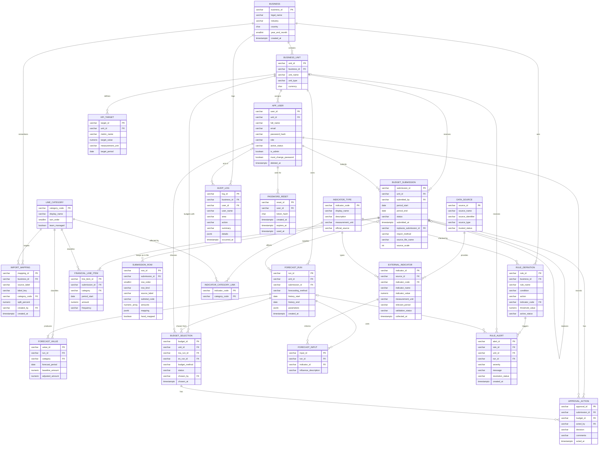

# Shared PostgreSQL schema

This folder owns **all 22 tables**: the 14 from the original design plus 3 reference tables, `import_mapping`, `submission_row`, `budget_selection`, `audit_log` and `password_reset`. No service creates or changes tables itself:

- The C# API (EF Core) only **reads and writes** tables that already exist.
- The Python forecasting service does the same.

## Data design (ERD)

The SQL source of truth is `init/01_schema.sql`; this diagram matches it.



| Table | Purpose |
|---|---|
| `business` | The SME using the system; `year_end_month` maps "FY2024" to dates (default February) |
| `business_unit` | Operating area; the app uses one "Whole company" unit per business for now |
| `app_user` | Users with one role: `submitter`, `approver` or `decision_maker` |
| `password_reset` | One-time emailed password reset links (token stored as a hash, 30 minutes) |
| `budget_submission` | One uploaded set of income statement history; versioned via `replaces_submission_id` |
| `financial_line_item` | One amount per category per period |
| `submission_row` | The upload's rows exactly as in the file, with each line's chosen mapping |
| `approval_action` | Approvals and rejections of uploads and budgets (rejections need a comment) |
| `import_mapping` | Remembered "spreadsheet label → category" choices per business, with % splits |
| `line_category` | The 13 fixed income statement categories |
| `indicator_type` | The external indicators the system tracks |
| `indicator_category_link` | Which categories each indicator affects |
| `data_source` | Where external data came from |
| `external_indicator` | Validated indicator values per period |
| `forecast_run` | One forecasting event: method, history window, parameters |
| `forecast_value` | Forecast amount per category and future period (baseline, optional adjusted) |
| `budget_selection` | The forecast pair a Decision Maker chose as the budget (MA, ES or their average) and its approval status |
| `forecast_input` | Which external indicators informed a forecast (reserved) |
| `kpi_target` | Targets per unit and period |
| `rule_definition` | Transparent warning rules with thresholds stored in the database, one set per business |
| `rule_alert` | Warnings raised when a rule triggers |
| `audit_log` | Activity log: who did what and when, kept for good |

## How it runs

Docker's `postgres` image runs every `.sql` file in `init/` in **alphabetical order** the first time the database volume is created.

```text
init/
  01_schema.sql          -- CREATE TABLE for all 22 tables (parents before children)  [written]
  02_reference_data.sql  -- categories, external indicator types, indicator -> category links, warning rules  [written]
  03_seed.sql            -- fictional demo business, users, income statement uploads, approved budget, KPI targets  [written]
```

## Demo data (`03_seed.sql`)

Everything is made up and matches the web app's demo mode: **Karoo Outdoor Supplies (Pty) Ltd**, retail, February year-end, one "Whole company" unit (`unit_id` `a0000000000000000000000000000001`).

| Sign-in | Password | Role | Status |
|---|---|---|---|
| `submitter@demo.co.za` (Sipho Ndlovu) | `demo123` | `submitter` | active |
| `approver@demo.co.za` (Anika Pillay) | `demo123` | `approver` | active |
| `owner@demo.co.za` (Johan van Wyk) | `demo123` | `decision_maker` | active |
| `test@gmail.com` (Test User) | `test` | `decision_maker` | active |
| `thandi@demo.co.za` (Thandi Mokoena) | `demo123` | `submitter` | inactive (sign-in refused) |
| `admin@gmail.com` (Admin) | `admin` | `decision_maker` + **admin** (`is_admin = true`) | active |

Passwords are stored as BCrypt hashes. The admin password is a development placeholder: change it before any real use.

## Admin and deleted users (`app_user`)

- **Admin** is not a fourth role: `role` stays `submitter`, `approver` or `decision_maker`, and `is_admin = true` marks the account (meant for senior IT management). Only an admin can change or delete an admin account, and only an admin can delete users who have history. `is_admin` is set in the database, not through the app.
- **Deleting a user with history** (uploads, approval decisions or remembered mappings point to them) keeps the row: `deleted_at` is set, `active_status` becomes `inactive`, `password_hash` is cleared and `is_admin` is false (a `CHECK` enforces this). The person can't sign in and drops out of the user list, but every record still points to them; screens show them as "Name (former user)". Users with no history are removed completely.
- **Email** is unique (not case-sensitive) among users that aren't deleted (`ux_app_user_email_current`), so a deleted user's email can be given to a new account.

| Upload | Years | Status |
|---|---|---|
| `Karoo_Outdoor_IS_FY2020-FY2024.xlsx` | FY2020–FY2024 | `superseded` (by the FY2021–FY2025 upload) |
| `Karoo_Outdoor_IS_FY2021-FY2025_draft.xlsx` | FY2021–FY2025 | `rejected` (interest paid missing for FY2023) |
| `Karoo_Outdoor_IS_FY2021-FY2025.xlsx` | FY2021–FY2025 | `approved`: the history forecasts use |
| `Karoo_Outdoor_IS_FY2022-FY2026.xlsx` | FY2022–FY2026 | `submitted` (waiting for the Approver; "Water & electricity" split 70 / 30) |

The last two also have their file rows (`submission_row`) so the web app can show and combine them; "Franchise levy" in the waiting upload was mapped by hand. Plus the remembered label mappings for that last upload and 5 KPI targets.

**Approved budget:** one forecast pair on the approved FY2021–FY2025 history (Moving Average, 3-year window, and Exponential Smoothing, α 0.5; FY2026, worked out in SQL with the same maths as the Python service, e.g. revenue R10 350 000 / R10 409 375), with **Exponential Smoothing** chosen as the budget by Johan van Wyk and approved by Anika Pillay.

The scripts only run on an **empty** volume. After changing a script, reset the database:

```powershell
cd ..
docker compose down -v
docker compose up -d
```

`down -v` deletes the database volume and all data in it (the demo data comes back from `03_seed.sql`). Re-run the ingest (`POST /api/ingestion/run`) afterwards to refill the external indicators.

## Conventions in `01_schema.sql`

- **IDs:** every primary key is `VARCHAR(32)`, a UUID without dashes (C# `Guid.ToString("N")`). Services may supply their own ID; if they don't, Postgres generates one. Reference tables use readable codes instead (`category_code`, `indicator_code`).
- **Money:** `NUMERIC(18,2)`. **Indicator values / rule thresholds:** `NUMERIC(18,6)`.
- **Timestamps:** `TIMESTAMPTZ` (UTC). **Calendar periods:** `DATE` (first day of the period), except `external_indicator.relevant_period`, which stays text (`"2024"`) for the C# API.
- **Forecast parameters:** `forecast_run.parameters` is `JSONB`, e.g. `{"window_size": 3}` or `{"alpha": 0.5}`.

## Allowed status values (enforced by `CHECK` constraints)

Every service must use exactly these lowercase strings, or the insert is rejected.

| Table.column | Allowed values |
|---|---|
| `business.year_end_month` | `1`–`12` (last month of the financial year; default `2` = February) |
| `business_unit.unit_type` | `company` (default; the app's one "Whole company" unit), `store`, `branch`, `department` |
| `app_user.role` | `submitter`, `approver`, `decision_maker` |
| `app_user.active_status`, `rule_definition.active_status` | `active`, `inactive` |
| `budget_submission.status` | `draft`, `submitted`, `approved`, `rejected`, `superseded` |
| `budget_submission.import_method` | `template`, `mapped_import`, `manual` |
| `budget_submission.source_scale` | `1`, `1000` (R'000), `1000000` (R million) |
| `financial_line_item.frequency` | `monthly`, `quarterly`, `annual` (default) |
| `import_mapping.split_percent` | above 0, up to 100 (rows for one label must add up to 100 — checked by the importer) |
| `approval_action.decision` | `approved`, `rejected` (a rejection must have `comments`; each row points to exactly one of `submission_id` or `budget_id`) |
| `budget_selection.budget_method` | `moving_average`, `exponential_smoothing`, `combined` (the average of the two, per category) |
| `budget_selection.status` | `submitted`, `approved`, `rejected`, `superseded` (at most one `submitted` and one `approved` per unit) |
| `data_source.source_type` | `api`, `spreadsheet`, `dataset`, `manual` |
| `data_source.trusted_status` | `trusted`, `untrusted` |
| `external_indicator.validation_status` | `pending`, `validated`, `flagged`, `rejected` |
| `forecast_run.forecasting_method` | `moving_average`, `exponential_smoothing` |
| `rule_alert.severity` | `info`, `warning`, `critical` |
| `rule_alert.resolution_status` | `open`, `acknowledged`, `resolved` |
| `audit_log.area` | `account`, `upload`, `forecast`, `budget`, `target`, `rule`, `business`, `user` |
| `audit_log.action` | `registered`, `signed_in`, `sign_in_failed`, `uploaded`, `approved`, `rejected`, `ran`, `chosen`, `added`, `changed`, `switched_off`, `switched_on`, `deleted`, `reset_requested` |

`external_indicator.indicator_code` and `rule_definition.indicator_code` must exist in `indicator_type` (foreign key). `financial_line_item.category`, `forecast_value.category` and `import_mapping.category_code` must exist in `line_category`.

## Income statement uploads

**History length:** 3–5 years of annual statements, or at least 24 months of monthly reports (monthly preferred). Older years are not used.

**External data uses the same time frame:** for each business, alerts and forecast inputs only use indicator periods inside its approved income statement history (e.g. FY2022 onwards → indicators from 2022). Approver / Decision Maker can request a longer range. Indicators are calendar years; they are matched to financial years with `business.year_end_month`.

- **One upload = one `budget_submission`.** `period_start` / `period_end` span every period in the file (e.g. 5 financial years).
- **One `financial_line_item` per category per period.** `period_start` is the first day of the month, quarter or financial year (for a February year-end, FY2025 starts `2024-03-01`). Amounts are stored in rands after applying `source_scale`, **as positive figures for income and expenses alike** (the category says which it is; the bracketed negatives on a sheet are flipped on import).
- **Combining uploads:** all `approved` submissions of a unit together form its history. A newer upload adds its periods; where two approved uploads cover the same category and period, the more recently submitted one wins. Only the latest 5 years are used. A file may hold a single year. Save every category for every period of an upload (0 where the file has no lines), so a newer upload's year fully replaces the older one.
- **Re-uploads (versioning):** a corrected upload sets `replaces_submission_id` to the rejected version it replaces. When the new one is approved, the old one's status becomes `superseded`. An approved upload whose periods are all covered by newer approved uploads also becomes `superseded`. Superseded uploads are kept for history, never deleted. Forecasts read only `approved` submissions.
- **File rows (`submission_row`):** every row of the uploaded statement as it was in the file, in order (`row_order`): `row_kind` `heading`, `line`, `subtotal` (with `subtotal_code`) or `total`, the label, `amounts` (one per year, in file units before `source_scale`, signs as in the file, `NULL` for an empty cell), and for lines the chosen `mapping` (`JSONB`, e.g. `[{"category": "electricity", "percent": 70}, {"category": "other_utilities", "percent": 30}]`) and `hand_mapped`. The web app shows these to the Approver and on the dashboard; forecasts use `financial_line_item`.
- **Remembered mappings (`import_mapping`):** per business, `label_key` (trimmed, lower case, single spaces) → category. A normal label has one row at 100%. A cross-category line has one row per category, e.g. "Water & electricity" → 70% `electricity` + 30% `other_utilities`. Split rows are summed into their categories before line items are saved.

## Forecasts and the chosen budget (`forecast_run`, `budget_selection`)

- Every forecast runs **both** methods: the Python service saves one `forecast_run` per method (same `created_at`), each with a `forecast_value` per category and future period.
- **Choosing the budget** saves a `budget_selection`: the Moving Average run (`ma_run_id`), the Exponential Smoothing run (`es_run_id`), the `budget_method` (one of the two, or `combined` = (MA + ES) ÷ 2 per category, worked out when shown) and who chose it. It starts as `submitted`; a newer choice makes a waiting one `superseded`.
- **Approving or rejecting** it adds an `approval_action` with `budget_id` set. Approving makes the unit's previous approved budget `superseded`. Runs used by a budget can't be deleted (foreign key).

## Activity log (`audit_log`)

- The API writes one row for every sign-in (including failed ones on a known email), registration, upload, decision, forecast run, budget choice and every change to KPI targets, warning rules, business details and users, in the same save as the change itself.
- `summary` is one readable line ("Approved upload Karoo_FY2025.xlsx"); `details` is a `JSONB` list of `{ field, before, after }` (e.g. a threshold change, a rejection comment). Passwords are never stored, only "Temporary password set".
- `user_name` keeps the person's name at the time, so a hard-deleted user's rows survive with `user_id` set to `NULL`. Rows are kept for good: nothing in the app edits or deletes them.
- The admin (`app_user.is_admin`) reads every row of the business; everyone else reads only their own.

## Passwords (`app_user.must_change_password`, `password_reset`)

- A password set by an Approver or Decision Maker (new user, or a forgotten password) is temporary: `must_change_password` is `true` until the person chooses their own at the next sign-in. Registering, changing your own password or using a reset link sets it back to `false`.
- "Forgot password?" adds a `password_reset` row and emails a one-time link. Only the SHA-256 hash of the link's token is stored (`token_hash`); the link works for 30 minutes (`expires_at`) and once (`used_at`). Asking again deletes the person's unused links. Rows go when the user is hard-deleted (`ON DELETE CASCADE`).

## Income statement categories (`line_category`)

Every imported income statement row is mapped to one of these fixed categories (based on IFRS for SMEs, expenses classified by nature). Forecasting runs per category. Inserted by `02_reference_data.sql`.

| # | `category_code` | Category | Team-managed | Typical source labels |
|---|---|---|---|---|
| 1 | `revenue` | Revenue | **Yes** | Sales, Turnover, Income, Income from services |
| 2 | `other_income` | Other income | | Interest received, Sundry income |
| 3 | `cost_of_sales` | Cost of sales | | COGS, Purchases, Direct costs |
| 4 | `employee_costs` | Employee costs | **Yes** | Salaries, Wages, Salaries & wages, UIF, SDL |
| 5 | `occupancy` | Occupancy | | Rent, Rates, Lease, Rent & rates |
| 6 | `electricity` | Electricity | | Electricity, Eskom, Prepaid electricity |
| 7 | `other_utilities` | Water, telecoms and other utilities | | Water, Telephone, Internet |
| 8 | `transport_fuel` | Transport and fuel | | Fuel, Petrol, Diesel, Delivery costs, Motor vehicle expenses |
| 9 | `marketing` | Marketing | | Advertising, Promotions |
| 10 | `other_operating` | Other operating expenses | | Admin, Bank charges, Repairs |
| 11 | `depreciation` | Depreciation and amortisation | | Depreciation |
| 12 | `finance_costs` | Finance costs | | Interest paid |
| 13 | `income_tax` | Income tax | | Tax, SARS |

**Team-managed** categories (sales and salaries) are set by the business itself, e.g. salaries at inflation + 1%. No external indicator applies to them.

Subtotals (gross profit, operating profit, profit before tax, net profit) are **not** categories. The system calculates them and compares them with the sheet's own subtotals as a validation check.

**Mapping rules** (for the planned Excel importer; choices saved in `import_mapping`)

- Rows are matched by **label, not row position**.
- Known labels (including same-category combined lines such as "Salaries & wages") map automatically.
- Unknown labels prompt the user to choose a category once; the choice is saved per business.
- Cross-category combined lines (e.g. "Water & electricity", "Rent & electricity") prompt once: assign to one category **or** split by percentage (e.g. 70% Electricity / 30% Water, telecoms and other utilities). The choice is saved and reused. The system never invents a split.

## External indicators (`indicator_type`, `indicator_category_link`, `rule_definition`)

The C# API fetches these automatically (annual % change, South Africa). Each indicator is linked to the income statement categories it affects. Warning rules belong to a business (`rule_definition.business_id`, names unique per business, case-insensitive); the demo business starts with one rule per indicator, and the API gives every newly registered business the same 4 rules.

| `indicator_code` | Indicator | API source | Linked categories | Rule threshold |
|---|---|---|---|---|
| `cpi_headline` | Consumer inflation (headline CPI) | World Bank `FP.CPI.TOTL.ZG` | Cost of sales | 6% |
| `cpi_core` | Core inflation (replaces CPIX, discontinued 2009) | OECD `_TXCP01_NRG` | Occupancy; Water, telecoms and other utilities; Marketing; Other operating expenses | 6% |
| `electricity_price` | Electricity price change | OECD `CP045` | Electricity | 10% |
| `fuel_price` | Fuel price change | OECD `CP0722` | Transport and fuel | 10% |

Thresholds are starting values to confirm with the business. Users change them in Targets & rules (`/api/rules`); the demo values are in `03_seed.sql`. To add an indicator: insert it into `indicator_type`, link it to categories, add rules for the businesses, and add its API series to `IndicatorCatalog.cs`.

## Differences from the original ERD

- `app_user.password_hash` added (nullable) for the API login; `is_admin` and `deleted_at` added for the admin and kept-history deletes; email uniqueness moved to a partial index that skips deleted users.
- `rule_definition.threshold_value` and `indicator_code` added so rules are configured in the database, not in code; `business_id` added so each business has its own rules (name unique per business instead of globally).
- `external_indicator.indicator_code` added (stable code; unique per source and period).
- New reference tables: `line_category`, `indicator_type`, `indicator_category_link`.
- New table `import_mapping` (remembered label → category choices per business, with % splits).
- New table `submission_row` (each upload's rows as in the file, with the chosen mapping).
- New table `audit_log` (who did what and when, for the activity log).
- New table `password_reset` (one-time emailed reset links) and `app_user.must_change_password` (temporary passwords).
- New table `budget_selection` (which forecast became the budget, and its approval status); `approval_action.submission_id` is nullable and `budget_id` added, so one table holds decisions on uploads and budgets.
- `business.year_end_month` added; `business_unit.unit_type` gains `company`.
- `budget_submission`: `replaces_submission_id`, `import_method`, `source_file_name`, `source_scale` added; status gains `superseded`.
- `financial_line_item.period_start` added (one row per category per period); `category` is now a foreign key to `line_category`, as is `forecast_value.category`.
- `forecast_run.historical_period` split into `history_start` / `history_end` (`DATE`); `submission_id` is nullable because a forecast usually draws on several approved submissions.
- `forecast_value.forecast_period` and `kpi_target.target_period` are `DATE`.

## Column types the existing C# code expects

The C# API maps these tables. Keep these names and types so EF Core can read and write them:

| Table | Column | PostgreSQL type |
|---|---|---|
| `data_source` | `source_id` (PK), `source_name`, `source_identifier`, `source_type`, `trusted_status` | `VARCHAR` (IDs are 32-character GUID strings) |
| `external_indicator` | `indicator_id` (PK), `source_id` (FK → `data_source`), `indicator_code` (FK → `indicator_type`), `indicator_name`, `measurement_unit`, `relevant_period`, `validation_status` | `VARCHAR` |
| | `indicator_value` | `NUMERIC(18,6)` |
| | `collected_at` | `TIMESTAMPTZ` |
| `rule_definition` | `rule_id` (PK), `business_id` (FK → `business`, **required**), `rule_name` (unique per business, case-insensitive), `condition`, `action`, `indicator_code` (FK → `indicator_type`), `active_status` | `VARCHAR` |
| | `threshold_value` (rules without one are skipped) | `NUMERIC(18,6)` |
| `rule_alert` | `alert_id` (PK), `rule_id` (FK → `rule_definition`, **required**), `unit_id` (FK → `business_unit`, nullable), `run_id` (FK → `forecast_run`, nullable), `severity`, `message`, `resolution_status` | `VARCHAR` |
| | `created_at` | `TIMESTAMPTZ` |
| `line_category` | `category_code` (PK), `display_name` | `VARCHAR` |
| | `sort_order` / `team_managed` | `SMALLINT` / `BOOLEAN` |
| `indicator_type` | `indicator_code` (PK), `display_name`, `description`, `measurement_unit`, `official_source` | `VARCHAR` |
| `indicator_category_link` | `indicator_code` + `category_code` (composite PK, both FKs) | `VARCHAR` |
| `budget_submission` | `submission_id` (PK), `unit_id`, `submitted_by`, `status`, `replaces_submission_id`, `import_method`, `source_file_name` | `VARCHAR` |
| | `period_start` / `period_end` / `source_scale` / `submitted_at` | `DATE` / `DATE` / `INTEGER` / `TIMESTAMPTZ` |
| `submission_row` | `row_id` (PK), `submission_id` (FK, cascade delete), `row_kind`, `source_label`, `subtotal_code` | `VARCHAR` |
| | `row_order` / `amounts` / `mapping` / `hand_mapped` | `SMALLINT` / `NUMERIC(20,6)[]` / `JSONB` / `BOOLEAN` |
| `financial_line_item` | `line_item_id` (PK), `submission_id` (FK), `category` (FK → `line_category`), `frequency` | `VARCHAR` |
| | `period_start` / `amount` | `DATE` / `NUMERIC(18,2)` |
| `import_mapping` | `mapping_id` (PK), `business_id`, `source_label`, `label_key`, `category_code`, `created_by` | `VARCHAR` |
| | `split_percent` / `created_at` | `NUMERIC(5,2)` / `TIMESTAMPTZ` |
| `approval_action` | `approval_id` (PK), `submission_id` (FK, nullable), `budget_id` (FK, nullable), `acted_by`, `decision`, `comments` | `VARCHAR` |
| | `acted_at` | `TIMESTAMPTZ` |
| `forecast_run` | `run_id` (PK), `unit_id`, `forecasting_method` | `VARCHAR` |
| | `history_start` / `history_end` / `parameters` / `created_at` | `DATE` / `DATE` / `JSONB` / `TIMESTAMPTZ` |
| `forecast_value` | `value_id` (PK), `run_id` (FK, cascade delete), `category` | `VARCHAR` |
| | `forecast_period` / `baseline_amount` / `adjusted_amount` | `DATE` / `NUMERIC(18,2)` / `NUMERIC(18,2)` |
| `budget_selection` | `budget_id` (PK), `unit_id`, `ma_run_id`, `es_run_id` (FKs → `forecast_run`), `budget_method`, `status`, `chosen_by` | `VARCHAR` |
| | `chosen_at` | `TIMESTAMPTZ` |
| `audit_log` | `log_id` (PK), `business_id` (FK → `business`), `user_id` (FK → `app_user`, nullable), `user_name`, `area`, `action`, `summary` | `VARCHAR` |
| | `details` / `occurred_at` | `JSONB` / `TIMESTAMPTZ` |
| `app_user` | `must_change_password` | `BOOLEAN` |
| `password_reset` | `reset_id` (PK), `user_id` (FK → `app_user`, cascade delete) / `token_hash` (unique) | `VARCHAR` / `CHAR(64)` |
| | `created_at` / `expires_at` / `used_at` | `TIMESTAMPTZ` |

C# `DateTime` values are written in UTC, which Npgsql requires to be `TIMESTAMPTZ` (not `TIMESTAMP`).
